<p align="center">
  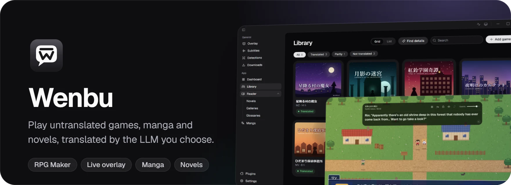
</p>

<p align="center">
  <a href="https://github.com/xianoem/wenbu/releases/latest"></a>
  
  <a href="https://github.com/xianoem/wenbu/actions/workflows/build.yml"></a>
  <a href="LICENSE"></a>
</p>

<p align="center">
  <a href="https://github.com/xianoem/wenbu/releases/latest"><b>Download for Windows</b></a>
  &nbsp;·&nbsp;
  <a href="#games">Games</a>
  &nbsp;·&nbsp;
  <a href="#beyond-games">Beyond games</a>
  &nbsp;·&nbsp;
  <a href="#plugins">Plugins</a>
  &nbsp;·&nbsp;
  <a href="#install">Install</a>
</p>

<br>

Wenbu is a Windows app for Japanese games, manga and novels that were never translated. Add a game or a folder of pages, choose an LLM, and Wenbu does the rest. When you want a closer look, every step is there to inspect and adjust: the lines it sent, the glossary it used, what each model cost.

## Games

### Your library

Add a game folder and Wenbu works out its engine, how much text it has and how long the story runs. **Find details** looks the game up on DLsite for its cover, circle, tags and rating, and the library keeps track of what you played and what is translated.

<p align="center">
  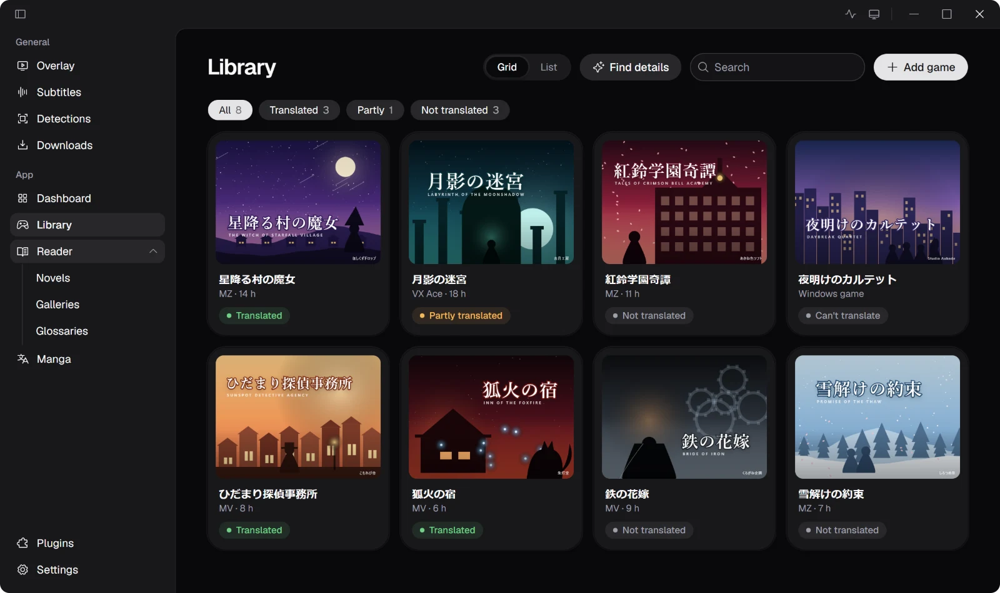
</p>

<table>
  <tr>
    <td width="50%" valign="top">
      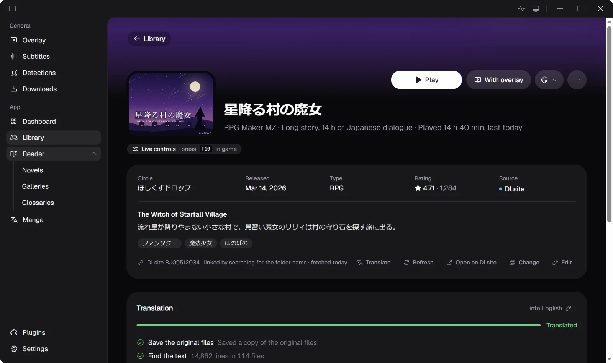
      <h3>RPG Maker, translated out of the box</h3>
      RPG Maker MV, MZ and VX Ace games are translated with one click. Wenbu backs up the original files, extracts every line, translates it with your preset and writes it back into the game.
      <br><br>
      Want more control? Review and edit any line, translate only what changed after a game update, and cap what a run may spend.
    </td>
    <td width="50%" valign="top">
      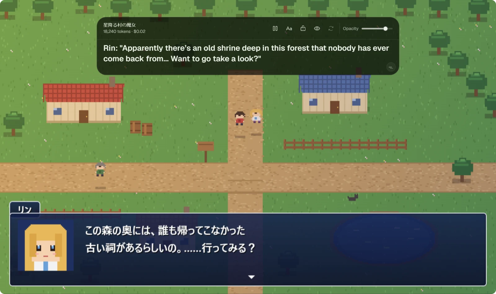
      <h3>Any other engine, through the overlay</h3>
      Games on other engines start in a Japanese locale with Ntleas or Locale Remulator, and <a href="https://github.com/HIllya51/LunaTranslator">LunaHook</a> reads their text as it appears. Each line shows up translated in a floating window above the game.
      <br><br>
      Move it, lock it, restyle it, or show the original line too.
    </td>
  </tr>
</table>

### The dashboard

See what you spent per day, per model and per game, which translations still have lines left, and what is popular on DLsite this week, with the games you already own marked.

<p align="center">
  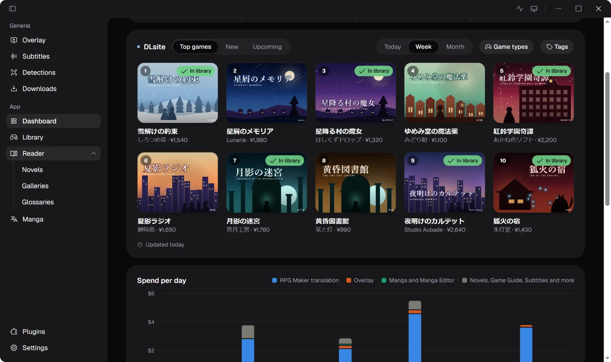
</p>

## Beyond games

<table>
  <tr>
    <td width="50%" valign="top">
      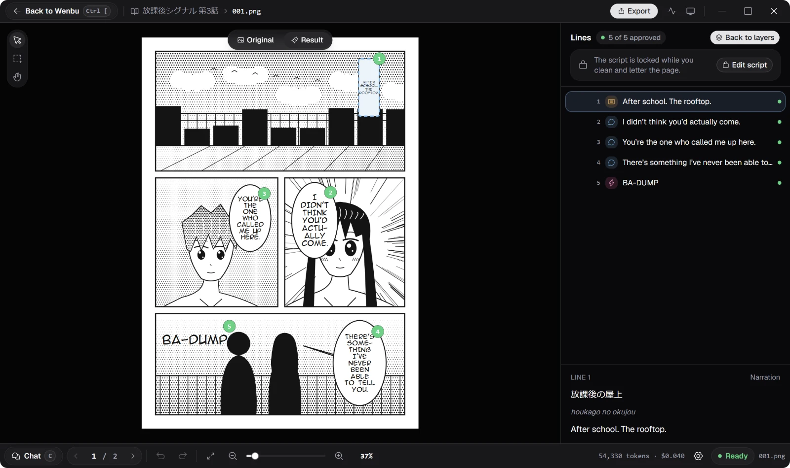
      <h3>Manga</h3>
      Translate a folder of pages with <a href="https://github.com/zyddnys/manga-image-translator">manga-image-translator</a>: it finds the bubbles, cleans them and letters the translation. Open the editor to fix a line, redraw a box or brush away leftovers.
    </td>
    <td width="50%" valign="top">
      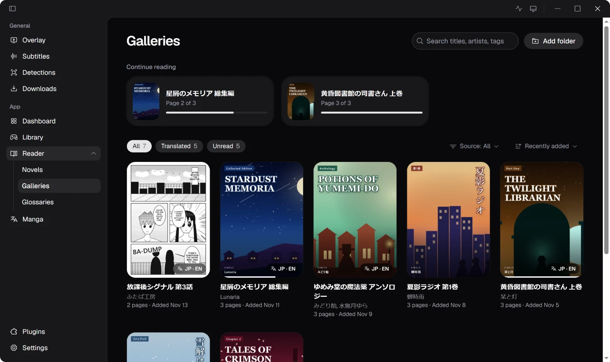
      <h3>Galleries</h3>
      Download doujinshi from supported sites straight into your galleries, translate them, and keep the Japanese and English versions together.
    </td>
  </tr>
  <tr>
    <td width="50%" valign="top">
      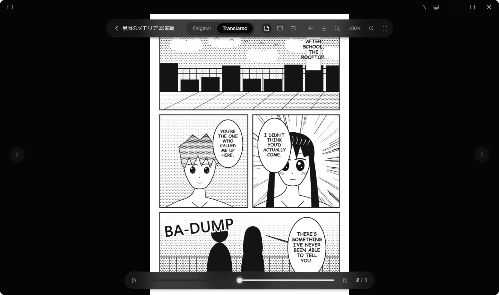
      <h3>Gallery viewer</h3>
      Read single pages, spreads or one long scroll, right to left or left to right, and press <kbd>T</kbd> to switch between the original and the translation.
    </td>
    <td width="50%" valign="top">
      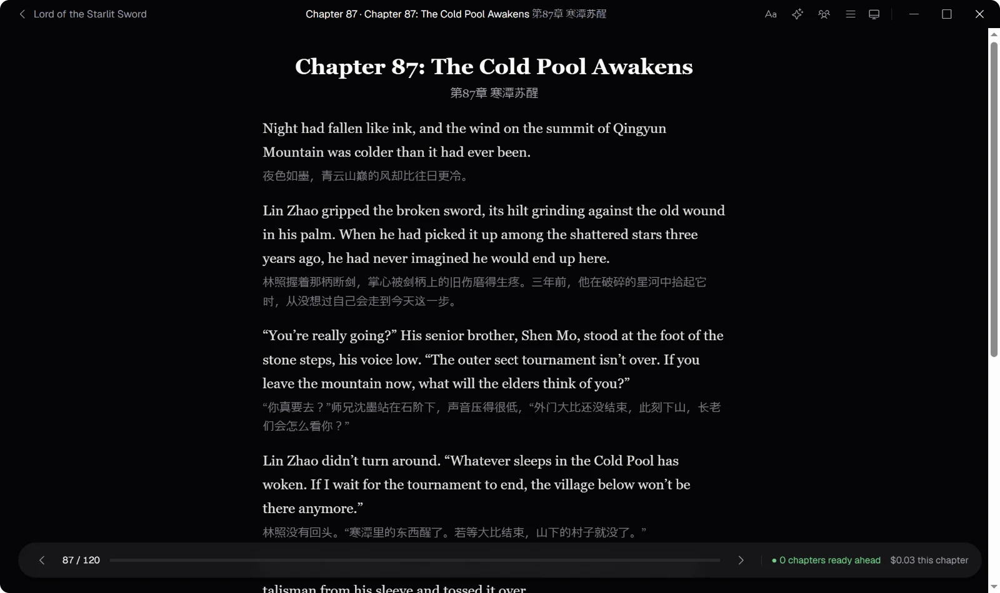
      <h3>Novels</h3>
      Follow web novels from supported sites, or paste the chapters yourself. Chapters are translated as you read, glossaries keep names consistent, and the original sits under each paragraph when you want it.
    </td>
  </tr>
  <tr>
    <td width="50%" valign="top">
      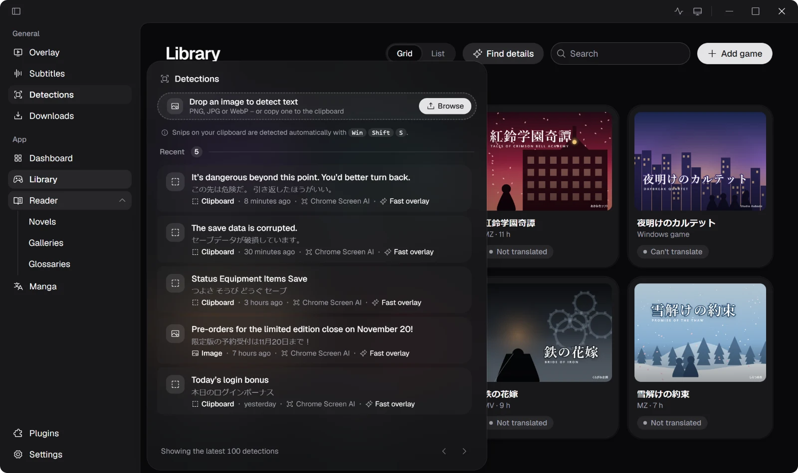
      <h3>Detections</h3>
      Snip any part of the screen with <kbd>Win</kbd> <kbd>Shift</kbd> <kbd>S</kbd> and Wenbu reads the text and translates it. Handy for menus, images and anything the overlay can't hook.
    </td>
    <td width="50%" valign="top">
      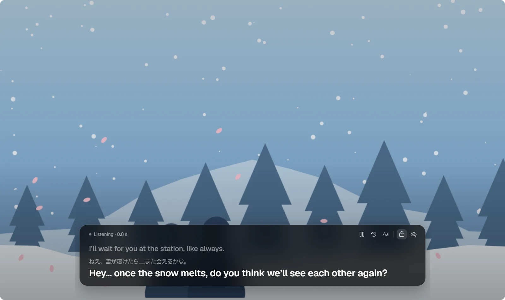
      <h3>Live subtitles</h3>
      Wenbu listens to your computer or one app, recognises the speech on your own GPU or CPU, and shows the translation as subtitles on top.
    </td>
  </tr>
</table>

## Plugins

Wenbu stays small. The heavy tools are opt-in: each downloads from its own project the first time you turn on the feature that needs it, and you can remove it again at any time.

| Plugin              | What it adds                                                                                    | Built on                                                                    |
| ------------------- | ----------------------------------------------------------------------------------------------- | --------------------------------------------------------------------------- |
| Translation Overlay | Reads text from running games and starts them in a Japanese locale                              | [LunaHook](https://github.com/HIllya51/LunaTranslator)                      |
| Manga Translator    | Finds, cleans and letters the text on manga pages                                               | [manga-image-translator](https://github.com/zyddnys/manga-image-translator) |
| Detections          | On-device text recognition for snips and images                                                 | Chrome Screen AI                                                            |
| Live Subtitles      | Speech recognition with Qwen3-ASR, SenseVoice Small, Whisper large-v3 turbo or Fun-ASR MLT Nano | transcribe.cpp                                                              |

<p align="center">
  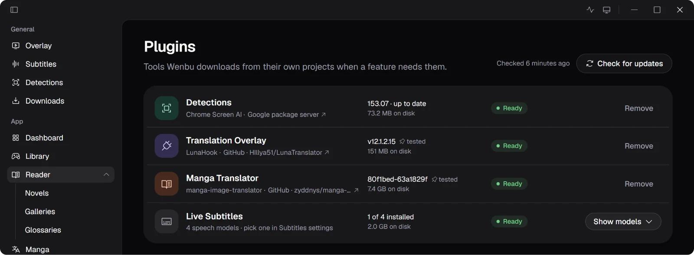
</p>

## Your models

Bring your own: Anthropic, OpenAI, Google, DeepSeek, Moonshot, or any OpenAI-compatible endpoint, local ones included. Presets choose the model and settings for each task, and every request is priced, so the dashboard always knows what you spent.

## Install

Download the latest `wenbu-…-setup.exe` from [Releases](https://github.com/xianoem/wenbu/releases) and run it. After that Wenbu keeps itself up to date: it downloads a new version in the background and installs it the next time you quit or restart.

> [!NOTE]
> The installer isn't code signed, so the first time you run it Windows SmartScreen shows "Windows protected your PC". Choose **More info**, then **Run anyway**. You see this once; updates install without it.

<details>
<summary><b>Why isn't the installer signed?</b></summary>
<br>

Wenbu is free and open source, and a signing certificate costs money every year. Windows doesn't know an unsigned installer, which is why SmartScreen asks first.

</details>

<details>
<summary><b>My antivirus flags Wenbu</b></summary>
<br>

To show a translation over a running game, Wenbu reads the game's text from inside the game's process. Some malware uses the same technique, so tools that judge by behaviour can mistake Wenbu for it. This is a false positive.

You don't have to take that on trust:

- Every installer is built from this repository's source by [GitHub Actions](https://github.com/xianoem/wenbu/actions), not on someone's computer.
- The source is here to read, and you can build the installer yourself with the steps below.

</details>

## Building from source

You need:

- [Node.js](https://nodejs.org) 24 and [pnpm](https://pnpm.io) 11
- [uv](https://docs.astral.sh/uv/)
- Visual Studio Build Tools 2022, with its C++ tools and CMake
- The [Vulkan SDK](https://vulkan.lunarg.com)

```bash
pnpm install
pnpm build:native
pnpm dev
```

Before sending a change, run:

```bash
pnpm check
pnpm test
pnpm build
```

`pnpm dist` builds the Windows installer.

## License

Wenbu is licensed under the [GNU General Public License v3.0](LICENSE).

The games, manga, novels and usage in the screenshots are made up for this page.
